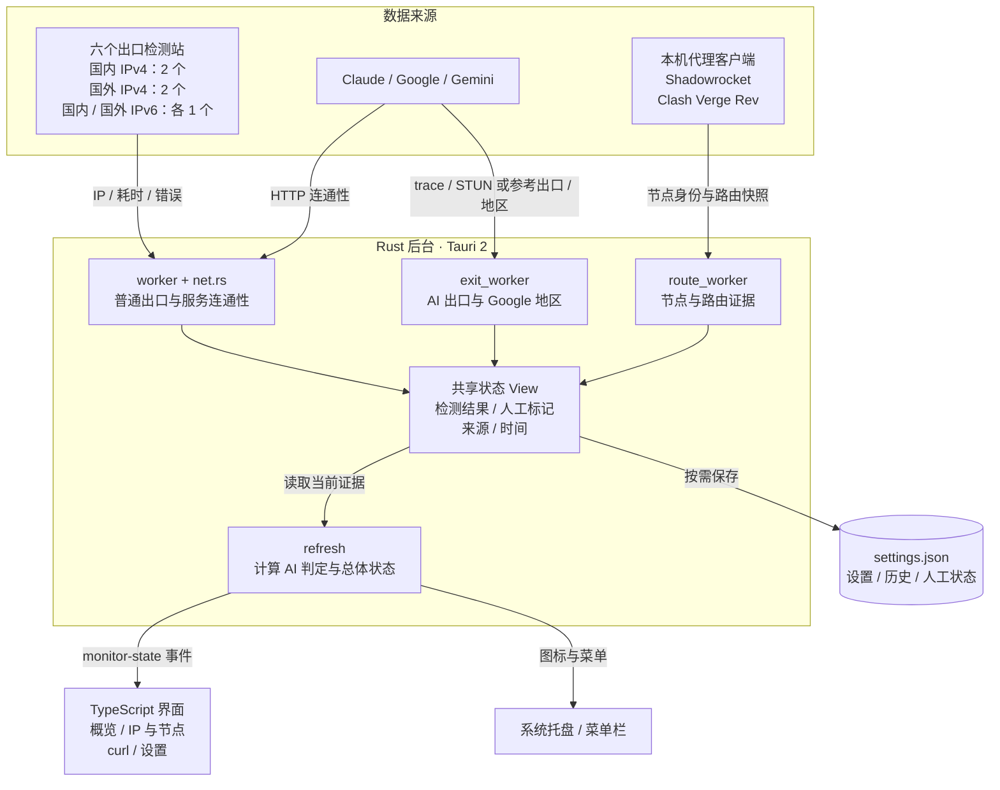
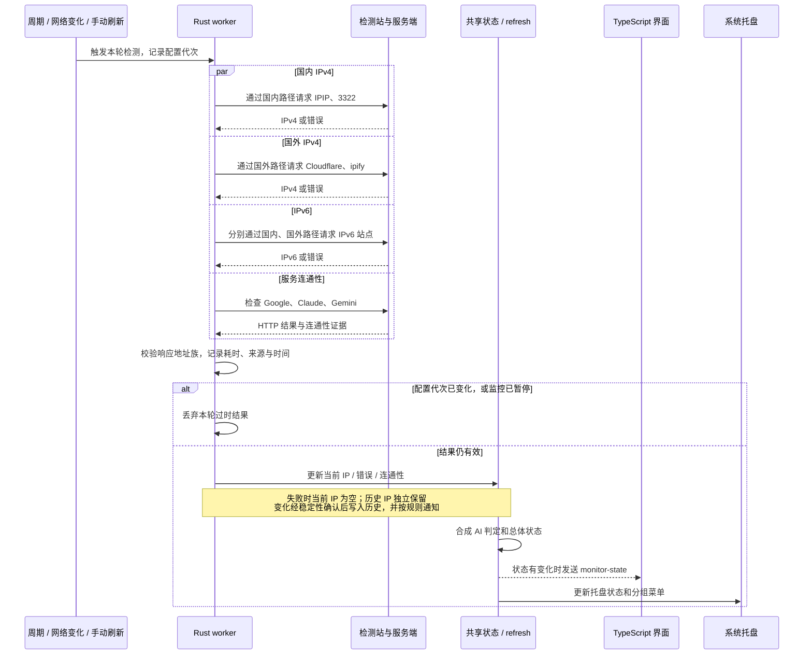
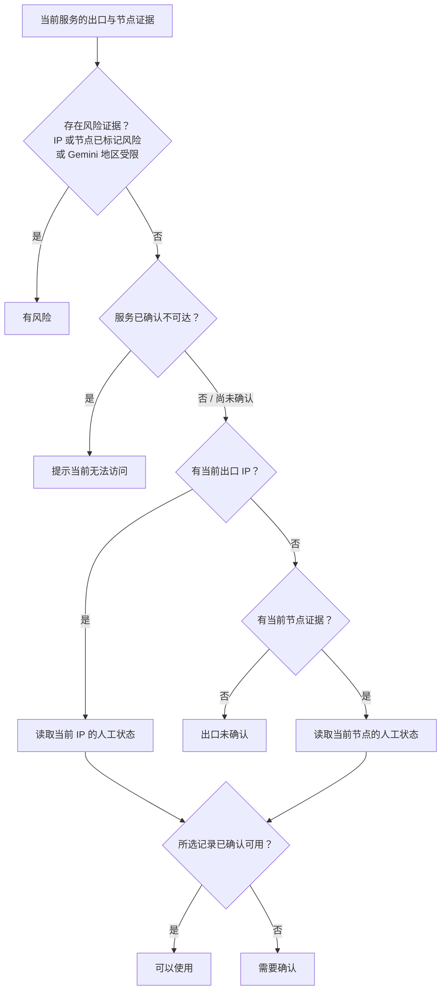

# 出口哨兵 · Exit Sentinel

macOS 菜单栏 / Windows 与 Linux 托盘应用，基于 Tauri 2。分别观测国内、国外及 AI 服务出口，记录网络变化并发送本机通知。

## 核心功能与实现原理

### 模块与数据流

前端通过 Tauri 命令读取和修改状态；Rust 后台执行网络检测、采集节点证据，再把当前结果合成为判定。界面和托盘共享同一份状态。



### 一轮网络检测怎样传递数据

普通出口检测和服务连通性检测并发执行。国内、国外使用各自的代理配置；IPv4、IPv6 分别验证和保存，互不回退。AI 出口另由 `exit_worker` 复核，不能用普通国外出口代替。



### Claude / Gemini 怎样得出结论

两个服务分别判断。当前出口的人工状态、节点状态和连通性共同参与；Gemini 额外参考 Google 对当前路径的地区判断。暂停时直接显示“监控已暂停”，运行中的判定顺序对应 `verdict.rs`：



Gemini 的地区受限指 Google 返回 `CHN`、`HKG` 或 `MAC`；其他服务不套用该规则。

例如：切换节点后出现新 IP，即使节点过去标记可用，新 IP 仍然需要确认；普通国外检测成功，也不能证明 Claude / Gemini 的当前路径或账号可用。

### 代码入口

| 核心机制 | 实现方式与代码入口 |
| --- | --- |
| 独立观测出口 | [`net.rs`](src-tauri/src/net.rs) 定义 2 个国内 IPv4、2 个国外 IPv4、国内与国外各 1 个 IPv6 检测站；按通道使用代理并校验返回地址族。失败会清空当前 IP，历史 IP 单独保留。 |
| 按需并发检测 | [`main.rs`](src-tauri/src/main.rs) 的 `worker` 根据周期、网络变化或手动刷新触发，并发执行出口与服务连通性检测。配置代次校验会丢弃已过时的请求结果。 |
| 观测 AI 实际路径 | [`exit_worker.rs`](src-tauri/src/exit_worker.rs) 独立复核 Claude trace、Gemini 的 Google 地区与 STUN / 参考出口；[`shadowrocket.rs`](src-tauri/src/shadowrocket.rs) 和 [`clash_verge.rs`](src-tauri/src/clash_verge.rs) 提供节点快照，保留取证来源。 |
| 给出保守判定 | [`verdict.rs`](src-tauri/src/verdict.rs) 合成当前出口、IP / 节点人工标记、连通性和地区证据。风险优先；有当前 IP 时以 IP 标记判断可用性，否则才参考节点标记。Gemini 还检查 Google 地区。 |
| 托盘、界面与通知 | Rust 维护共享状态并更新托盘，通过 `monitor-state` 事件驱动 [`src/main.ts`](src/main.ts) 的 TypeScript 界面；变化记录本地保存，并按监控规则发送本机通知。 |
| 辅助诊断与跨设备配置 | [`diagnostics.rs`](src-tauri/src/diagnostics.rs) 提供 curl 请求与阶段耗时；[`sync.rs`](src-tauri/src/sync.rs) 手动同步 WebDAV 配置；[`updates.rs`](src-tauri/src/updates.rs) 检查公开 Release，更新包由 Tauri 校验签名。 |

## 功能

- 国内 / 国外 IPv4、IPv6 检测站独立监控；可设置是否要求 IPv6 可用。
- IP 位置、ASN、运营商及保守网络类型参考，地理信息本地缓存。
- 美国出口显示是否为无州级销售税州；阿拉斯加额外提示地方销售税。参见 [销售税规则](docs/SALES-TAX.md)。
- 概览页给出 Claude / Gemini 当前判定（可以使用 / 需要确认 / 有风险），由当前出口 IP、当前节点的人工状态和连通性合成，可一键标记。
- Claude / Gemini 分别记录路径、IP、代理节点快照（macOS Shadowrocket / Windows 与 Linux Clash Verge Rev）及人工可用状态；导入的节点与实时节点按名称 + 服务器地址匹配。
- 网站 curl 诊断：状态码、阶段耗时、原始请求与响应，支持复制。
- 列表支持筛选、排序、分页和独立偏好记忆。
- 菜单栏 / 设置页开机自启开关；关闭窗口后后台运行。
- 从公开的 GitHub Release 自动检查更新，无需登录；下载后验证签名再安装并重启，可关闭自动检查。

## 安装

### Windows x64

从 [Release](https://github.com/melotusme/exit-sentinel-releases/releases/latest)下载 `Exit.Sentinel.windows.x64.exe`，安装后使用托盘图标。Windows 使用 Clash Verge Rev / Mihomo，不安装或调用 Shadowrocket、Python。首次启动如检测到 Clash Verge，将国外 / Claude / Gemini 检测代理预填为实际 mixed-port；国内代理保持独立，可在设置更改。支持 HTTP 控制器和 Windows 本机命名管道；默认读取 `%APPDATA%/io.github.clash-verge-rev.clash-verge-rev/clash-verge.yaml`。

### Linux x86_64（Omarchy / Arch）

以 AppImage 发布，可在应用内升级。先安装依赖：

```sh
sudo pacman -S --needed curl fuse2
```

安装或升级（脚本校验 SHA-256，备份旧版应用和设置，装到 `~/.local/bin/exit-sentinel.AppImage` 并注册启动器图标）：

```sh
curl -fsSL https://github.com/melotusme/exit-sentinel-releases/releases/latest/download/install-linux.sh -o /tmp/es-install-linux.sh && bash /tmp/es-install-linux.sh
```

Linux 读取 Clash Verge Rev 的 `~/.local/share/io.github.clash-verge-rev.clash-verge-rev/clash-verge.yaml`，支持 HTTP 控制器与 Mihomo 本机 Unix socket。托盘依赖 StatusNotifier（Omarchy 的 Waybar 托盘已支持）；WebDAV 密码保存在 Secret Service（GNOME Keyring 等）。Claude 桌面版仅识别社区 `claude-desktop` 包。默认设置 `WEBKIT_DISABLE_DMABUF_RENDERER=1`，避免 Wayland / NVIDIA 下窗口空白。

### Homebrew（Apple Silicon macOS）

```sh
brew tap melotusme/exit-sentinel
brew install --cask melotusme/exit-sentinel/exit-sentinel
```

源码、发布仓库和 tap 都是公开的，不需要 GitHub 登录。cask 固定版本并校验 SHA-256。升级使用 `brew update` 和 `brew upgrade --cask melotusme/exit-sentinel/exit-sentinel`，或应用内检查更新。

## WebDAV / 坚果云

设置 → WebDAV 配置同步：默认坚果云目录 `https://dav.jianguoyun.com/dav/`，填写账号和第三方应用密码，或点击“从本机 Clash Verge 导入”。自动创建 `ExitSentinel/` 子目录，专用文件 `exit-sentinel-v1.json` 不与 Clash Verge 备份混用。

连接保存到本机 `webdav.json`；应用密码存 macOS 钥匙串 / Windows 凭据管理器 / Linux Secret Service，读取时不返回界面。每台电脑分别配置凭据。

- 首台：保存连接 → 测试连接 → 上传本机配置。
- 其他设备：保存连接 → 下载并应用。下载前备份本机完整配置。
- 冲突时先下载核对；上传前发现云端变化会拒绝操作，上传前的旧云端版本保存为 backup 文件；坚果云不保证条件写入原子性，避免两台设备同时上传。同步为手动操作，不在后台覆盖。
- 同步检测偏好、AI 服务 IP / 节点与人工状态；本机代理、历史、缓存、开机自启独立保留。macOS 的 Shadowrocket 节点也可作为历史记录同步到 Windows，当前节点仍读取本机客户端。
- 云端 JSON 包含 IP、节点名称、备注；无端到端加密，请使用私有 WebDAV 目录。

## 开发

需要 Node.js 22+、Rust stable。macOS 需要 Xcode Command Line Tools；Windows 需要 Visual Studio C++ Build Tools 和 WebView2。Linux 需要 webkit2gtk-4.1、libayatana-appindicator、librsvg、libdbus 开发包（Ubuntu 包名见 `.github/workflows/check.yml`）。

```sh
npm ci
npm run build
npm test
npm run tauri -- dev
```

本机构建脚本绕过失效的全局 Cargo 镜像配置，不修改全局设置。正式更新包需要本机外置签名私钥或 CI Secret：参见 [发布说明](docs/RELEASING.md)。

## 隐私

无遥测，不读取 Claude 登录凭据，不修改代理规则。出口检测服务能看到请求来源 IP；无缓存时向 ipwho.is 查询出口地理信息；查看附近公开地点时向 Nominatim 发送粗略坐标。更新检查匿名访问公开的 GitHub Release，不发送本地监控记录，也不使用任何 GitHub 凭据。

Windows 配置位于 `%APPDATA%/dev.exit-sentinel.desktop/`，Linux 位于 `~/.local/share/dev.exit-sentinel.desktop/`。macOS 设置、IP 和节点记录保存在 `~/Library/Application Support/dev.exit-sentinel.desktop/settings.json`，Unix 权限 0600。0.5.1 之后的版本换了应用标识：首次启动会把旧标识 `local.<名字>.exit-sentinel` 下的设置和界面偏好复制过来，旧目录原样保留，确认无误后可以手动删除。该目录不打包、不提交。Shadowrocket 读取只保留节点身份和路由元数据，不导出密码、密钥或订阅链接。

当前应用使用 ad-hoc 签名，尚未做 Apple Developer ID 签名与公证；其他 Mac 的首次安装可能需要在系统设置允许打开。更新包签名独立于 Apple 签名。

[安全检查范围与结果](docs/SECURITY-REVIEW.md)
